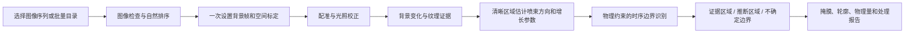

# 喷雾物理约束识别工具技术方案

版本：V1.0（方案评审稿）  
日期：2026-10-30  
项目目标：开发可复用的软件工具，对固定相机拍摄的喷雾图像序列进行自动识别，利用成像变化与喷雾发展规律，降低白色打光背景造成的误检和边界缺失。

## 1. 项目定位与交付目标

工具接收一个图像序列文件夹，完成一次工况设置和尺寸标定后，自动识别整段序列。相机位置和光学系统不变时，可复用标定；多个实验文件夹可批量处理。

核心任务是识别喷雾所在区域、跟踪喷束前沿，并区分图像证据与物理模型推断。背景去除图作为辅助结果。识别结果应能用于计算投影贯穿距离、投影面积、喷束方向与前沿位移速度。

交付包括：中文操作界面、独立算法模块、命令行与批处理入口、配置文件、识别结果导出、验证报告及使用说明。第一版采用可解释的图像处理与约束优化方法。

## 2. 当前样例与已知条件

| 项目 | 当前信息 | 使用方式 |
|---|---|---|
| 输入图像 | 70 张，1280×800，8位灰度 | 用作首组开发与演示数据 |
| 环境背压 | 用户确认 40 bar，即 4 MPa | 写入工况配置 |
| 视窗标定直径 | 用户确认红圈所示直径为 60 mm | 建立像素到毫米的换算 |
| 采样率 | 相机设置及头文件为 10000 帧/秒 | 连续帧条件下，时间间隔为 0.1 ms |
| 图像顺序 | 文件编号 000001—000070 连续 | 按自然序读取；连续导出暂作为运行假设记录 |
| 喷射压力标签 | 文件名为 140 MPa | 保留为工况标签；启用压差公式前核实其定义与压力基准 |
| 喷嘴孔径、液体密度、环境气体密度 | 当前未提供 | 不填入假定数值；对应公式项按条件启用 |

截图红圈映射回原始图像后，等效直径约为 689 px，对应约 0.0871 mm/px。这是当前手绘红圈得到的初始标定值；正式运行提供原图圆周标定和预览，便于检查实际选取的圆是否一致。

视窗中心与喷嘴中心分别设置。若两者不重合，各方向可观测的最大传播距离不同，不能统一把所有喷束距离截成 30 mm。

## 3. 适用范围

首版针对：固定相机、存在可获取的起喷前背景、喷嘴位置基本固定、喷雾主要从已知源点向外发展的图像序列。允许喷束数量、方向、打光分布、图像尺寸和工况参数变化。

工具自动估计喷嘴位置与圆形视窗，操作人员可以在代表帧上一次性修正。自动估计不是每组数据都可靠，因此界面必须展示标定叠加预览。

以下情况需扩展模型或单独验证：相机持续大幅运动、缺少任何背景信息、多个独立喷嘴、强燃烧发光、显著遮挡、镜头污染持续变化，以及不再满足源点向外发展假设的复杂流动。第一版不宣称适用于任意图像识别问题。

## 4. 技术路线

### 4.1 图像与元数据读取

第一版支持常见的 JPG、PNG、BMP 和8位 TIFF 序列。按文件名中的数字自然排序，检查分辨率、损坏文件、重复帧及明显编号缺失。不同分辨率的相机设置照片等附件单独列出，不混入主序列。

同分辨率但属于不同实验的文件需要通过序列选择或文件过滤规则区分。读取清单保留原文件名与内部帧序号的对应关系。

CHD 等采集头文件可以提供帧率、曝光信息，作为辅助元数据。工具不要求头文件中的完整记录帧数与当前选取的 JPEG 数量相同；截取的图像序列也可以处理。

### 4.2 一次标定与坐标系统

界面允许自动估计后确认，或在代表帧上点击喷嘴中心、点击标定圆周三点，并填写实际直径。一次标定适用于整段序列。

像素尺度为：

\[
k=\frac{D_{\mathrm{mm}}}{D_{\mathrm{px}}}
\]

投影长度和面积换算为：

\[
S_{\mathrm{mm}}=kS_{\mathrm{px}},\qquad A_{\mathrm{mm^2}}=k^2A_{\mathrm{px^2}}
\]

当前样例使用直径60 mm。圆周拟合略呈椭圆时，可先用等效直径建立近似尺度，并记录拟合误差；有明显透视畸变时需提供额外几何标定，不能直接将手绘椭圆当作精确透视校正依据。

所有距离为成像平面上的投影量。单相机结果不能直接代表三维喷雾长度或三维速度。

### 4.3 背景估计、配准与光照校正

用起喷前多帧的中位数构建背景：

\[
B(x,y)=\operatorname{median}_{t\in\mathcal B}I_t(x,y)
\]

同时估计背景噪声，形成随位置变化的检测阈值。当前样例先使用前5帧，工具允许调整。

若相机存在轻微抖动，先在静态窗框和非喷雾区域估计图像配准；光照整体漂移则在稳定背景区域拟合增益和偏置：

\[
I_t^{\mathrm{corr}}=\frac{I_t-b_t}{a_t}
\]

背景更新只允许发生在高置信度非喷雾区域，防止缓慢发展的喷雾被逐渐吸收到背景中。

### 4.4 建立图像证据

单帧观测可概括为：

\[
I_t=T_tB+L_{\mathrm{sc},t}+\eta_t
\]

其中，\(T_t\) 表示背景光透射变化，\(L_{\mathrm{sc},t}\) 表示进入相机的散射或附加光信号。喷雾既可能增加亮度，也可能削弱背景，因此背景差分不是散射信号的精确反演。

识别特征包括：正、负背景残差，残差相对噪声的幅度，相邻帧变化，局部边缘和纹理，以及饱和区域标记。由这些特征构建图像前景证据 \(p_{\mathrm{img}}\)。第一版采用可解释的概率映射；有足够标注数据后可替换为学习模型，物理约束模块保持独立。

固定白色背景的主要特点是位置稳定；喷雾在时间和空间上产生变化。若喷雾与背景灰度完全相同或图像已经饱和，图像证据应降低，而不是仅凭亮度判为喷雾。

## 5. 物理约束设计

### 5.1 喷嘴源点和传播方向

从早期清晰帧估计各喷束方向，不把12束写死。当前样例初步检测到12个方向，这只是该样例的图像估计。

将图像转换到以喷嘴为原点的极坐标，描述各方向前沿 \(r(\theta,t)\)，或分别跟踪第 \(j\) 条喷束前沿 \(S_j(t)\)。喷束方向、角宽和源点关联作为约束，但不能强制所有液滴与源点始终像素连通，避免删除已经破碎的液滴和脱落结构。

### 5.2 运动学与可观测范围

前沿位移应随时间连续：

\[
|S_j(t+\Delta t)-S_j(t)|\leq v_{\max}\Delta t+\epsilon
\]

在确认的早期外扩阶段，可加入适度的非回缩约束；进入喷射结束、回流或弥散阶段后放宽。不得要求全过程面积或前沿距离单调增加。

视窗限制写成：

\[
0\leq r(\theta,t)\leq R_{\mathrm{view}}(\theta)
\]

这里的 \(R_{\mathrm{view}}\) 是从喷嘴出发与视窗边界的交点距离。到达视野边缘只表示前沿可能不可继续观测，不自动证明发生撞壁；撞壁阶段切换还需要实验结构信息。

### 5.3 压差与出口速度尺度

压力与液体物性齐全、压力基准一致，且适用准稳态喷口近似时，使用出口速度尺度：

\[
U_0=C_v\sqrt{\frac{2(P_{\mathrm{inj}}-P_{\mathrm{amb}})}{\rho_l}}
\]

\(C_v\) 为速度系数，不与流量系数混用。该尺度用于检查自由发展阶段的前沿增量是否明显不合理；考虑投影、模型误差和适用阶段，不能把出口速度直接当成每个喷束前沿的真实速度。

当前环境压力已确认4 MPa；若140 MPa喷射压力及其基准确认，压差为136 MPa。液体密度和速度系数未确认前，不给出假定的绝对速度上界。

参数缺失时，暂以清晰区域观测得到的像素增量分布建立宽松的运动连续性约束，并在报告中标明其属于数据估计。

### 5.4 喷雾增长模型

在适用的自由喷雾条件下，可考虑以下增长尺度作为候选：

\[
S\sim C_1\sqrt{\frac{\Delta P}{\rho_l}}(t-t_0)
\]

\[
S\sim C_2\left(\frac{\Delta P}{\rho_g}\right)^{1/4}\sqrt{d_0(t-t_0)}
\]

第一式对应常见的早期速度尺度，第二式对应某些后期贯穿模型中的平方根时间尺度。其适用性与喷嘴、喷射率、破碎和环境条件有关，不能不分阶段强行套用。

当前缺少喷孔尺寸和气液物性时，采用可拟合的弱先验：

\[
\widehat S_j(t)=a_j(t-t_0)^{n_j}
\]

参数从清晰、未接近视野边界的观测拟合，并记录拟合残差和外推范围。早期增长可能具有加速过程，因此不预先把指数固定为0.5或1。只有在模型拟合可靠、适用阶段明确时才提高该项权重。

强反光方向可借用同工况清晰喷束的增长趋势，但保留本喷束早期尺度和允许偏差。不能把所有喷束设为完全相同的长度，也不能把这种借用称为独立测量。

## 6. 图像证据与物理模型融合

联合估计像素区域 \(M_t\) 和外包络 \(C_t\)，目标函数采用：

\[
E=E_{\mathrm{img}}+\lambda_pE_{\mathrm{growth}}+\lambda_tE_{\mathrm{temporal}}+\lambda_\theta E_{\mathrm{spatial}}
\]

- 图像项：优先保留实际亮度、纹理和时间变化证据。
- 增长项：弱对比区域的前沿与可靠增长模型保持相容。
- 时间项：限制前沿突跳，同时允许真实阶段变化。
- 空间项：抑制孤立噪点和异常尖刺，保留不同喷束之间的凹陷。

权重依据证据质量自适应调整。清晰区域主要服从图像；白色重合、低对比或饱和区域适度增强模型影响，并相应降低结果置信度。若增长模型本身残差大，也必须降低模型权重。

外包络与液相/图像前景掩膜分别输出。包络内的暗区不自动等同于喷雾像素，避免把喷束间隙全部填满。

白色背景去除图仅显示可提取的变化信号。模型可以估计边界位置，但不能凭空恢复完全丢失的喷雾纹理。

## 7. 软件工具设计

### 7.1 中文界面操作

1. 选择图像序列文件夹，或选择包含多个序列的父目录。
2. 自动检查图像，填写起喷前背景帧数和采样率。
3. 检查自动喷嘴/视窗预览；需要时一次点击喷嘴中心、三点标定圆周。
4. 填写已知直径、环境压力和可选物性，保存为实验配置。
5. 点击运行，自动处理整段序列，显示进度和异常信息。
6. 浏览结果、调整整段参数后重跑，或将同一标定应用于相同光学设置的其他实验。

无需人工逐帧擦除背景或逐帧描边。批处理时，每组序列单独估计背景；只有标定和光学设置相同时才复用几何参数。

### 7.2 模块结构

| 模块 | 职责 |
|---|---|
| 序列读取 | 文件过滤、自然排序、尺寸和完整性检查 |
| 标定与几何 | 喷嘴、圆形/椭圆视窗、尺度与视野范围 |
| 预处理 | 配准、噪声估计、光照校正、背景建模 |
| 图像证据 | 背景变化、纹理、时间变化、饱和检测 |
| 物理模型 | 前沿运动、阶段判断、可选压力和增长模型 |
| 约束求解 | 融合证据与先验，生成掩膜及轮廓 |
| 置信度 | 标识低证据、模型推断和无法可靠判断的位置 |
| 导出与界面 | 批处理、日志、表格、对照图和可视化 |

建议采用 Python、NumPy、OpenCV、SciPy、Pillow 实现算法，Tkinter 提供首版本地桌面界面。算法模块可独立调用，后续可接入其他界面或学习模型。

首版界面为本地运行，不依赖云端服务。保留命令行参数和 JSON 配置，便于重复实验和批处理。

## 8. 输出规范

每次运行建立独立结果目录，保存配置和原文件映射，不覆盖原始图像。

| 输出 | 内容 |
|---|---|
| 图像证据掩膜 | 有足够图像变化支持的区域 |
| 外包络掩膜 | 融合时序和模型后的投影覆盖范围 |
| 推断/不确定掩膜 | 包络中缺少直接证据的部分 |
| 边界叠加图 | 区分强证据与低证据轮廓 |
| 背景抑制图 | 供人工检查的前景变化信号 |
| 轮廓CSV | 帧号、角度、坐标、距离和证据标识 |
| 指标CSV | 各喷束前沿、面积、毫米单位及阶段标识 |
| 运行报告 | 标定、工况、假设、参数、异常和处理耗时 |
| 对照图和慢放 | 原图、基线方法、约束方法的统一尺度比较 |

有空间和时间标定时，按各喷束的平滑前沿轨迹计算投影位移速度；不把不同角度的前沿分位数跳变直接解释成某个喷束的速度。

置信度在未经人工验证前称为“证据强弱评分”，不能宣称为经过校准的正确概率。

## 9. 验证与验收

### 9.1 对照实验

至少比较：原图灰度阈值、背景差分、背景差分加时间约束、完整的图像与物理约束方法。再分别移除增长项和几何项，检查各项是否实际改善识别。

首先以当前70帧完成演示和问题定位。随后至少增加其他实验序列，用不同光照、喷束方向或发展速度检查泛化。当前单组数据不能支持跨工况泛化结论。

### 9.2 标注与指标

选择覆盖起喷、快速发展、与反光重合、后期弥散的代表帧，分别统计反光区和非反光区：

- 前景IoU、Precision、Recall。
- 边界距离误差或边界F-score，长度单位统一为毫米。
- 起喷前背景误检面积、前沿异常突跳次数。
- 推断区域比例、低证据区域覆盖情况和处理耗时。

对本身无法确定的模糊边界，标注可接受边界带并记录标注分歧，不能伪造一条精确真值。明确可标注区域与不确定区域各自的评估范围。

背景模型建立时使用的帧不能同时充当独立准确率验证。可以做留一背景帧检查，但它仍不能代替真实喷雾边界标注。

### 9.3 泛化与数据划分

按完整实验序列划分开发和验证数据，避免把相邻帧随机拆分后误认为独立验证。相同物理和光学设置的标定可以复用，物理参数则随工况配置。

合成数据用于检验静态白背景抑制、已知前沿恢复、几何范围和时间约束是否按设计工作；真实数据的准确率仍以真实标注结果为准。

### 9.4 首版验收条件

1. 可选择新文件夹并自然排序，自动处理整个序列。
2. 几何参数不写死为当前图像坐标或12条喷束。
3. 标定只需一次，输出毫米单位并保存换算依据。
4. 完成后可追溯原文件、配置、证据区域和推断区域。
5. 能在至少一组额外真实序列上运行，并提供对照及失败情况。
6. 是否达到准确率要求，以标注和对照实验结果判定；本方案不预先宣称精度提升比例。

## 10. 实施顺序

| 阶段 | 工作 | 可评审结果 |
|---|---|---|
| A：方案与数据规范 | 确认识别目标、标定流程、物理假设和输出定义 | 本技术方案及数据检查表 |
| B：可解释基线 | 通用读取、背景处理、证据掩膜和尺度换算 | 自动处理完整序列的基线工具 |
| C：物理约束识别 | 分喷束跟踪、模型拟合、时序融合和不确定性 | 约束结果、对照图及消融实验 |
| D：工具化与泛化 | 中文界面、配置复用、批处理、其他序列验证 | 可复用软件、使用说明和验证报告 |

现有单组数据探索原型用于确认可行性；工具化和泛化验收需按上述步骤继续验证。

## 11. 技术依据

- [Microscopic Imaging on Diesel Spray and Atomization Process](https://www.mdpi.com/2227-9717/12/2/359)：喷雾图像背景扣除及宏观参数提取的实验处理方法。
- [Analysis of the Influence of Diesel Spray Injection on the Ignition and Soot Formation in Multiple Injection Strategy](https://www.mdpi.com/1996-1073/13/13/3505)：背景处理与图像时间变化联合使用的相关方法。
- [Time resolved measurements of the initial stages of fuel spray penetration](https://doi.org/10.1016/j.fuel.2009.05.013)：初期喷雾增长可能具有加速阶段，支持分阶段选择增长模型。
- [Experimental study of temporal evolution of initial stage diesel spray under varied conditions](https://www.sciencedirect.com/science/article/abs/pii/S0016236115012764)：喷雾增长模型及不同条件下初期发展规律的实验研究。

本方案中的界面结构、证据与推断分开输出、自适应约束融合和验证流程，是针对当前项目提出的工程设计，需要通过项目数据验证。
